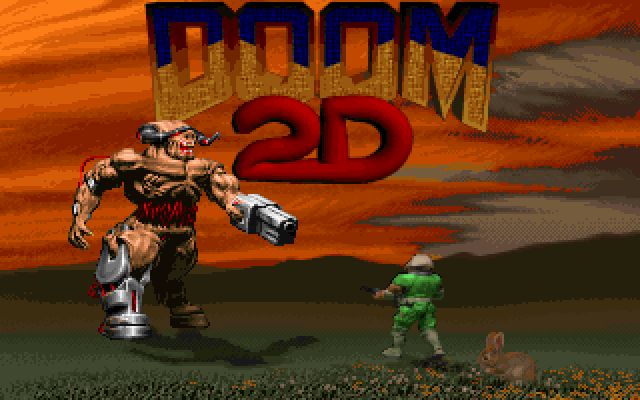
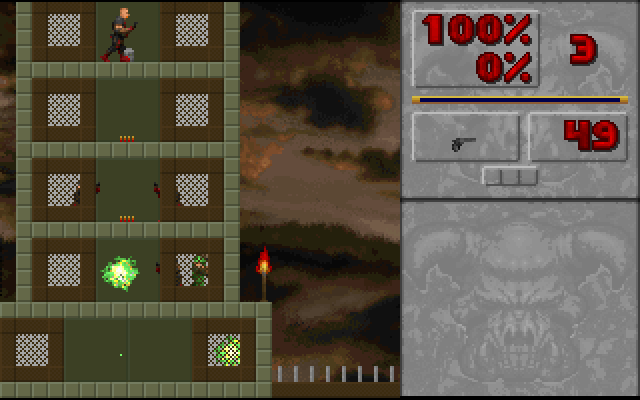
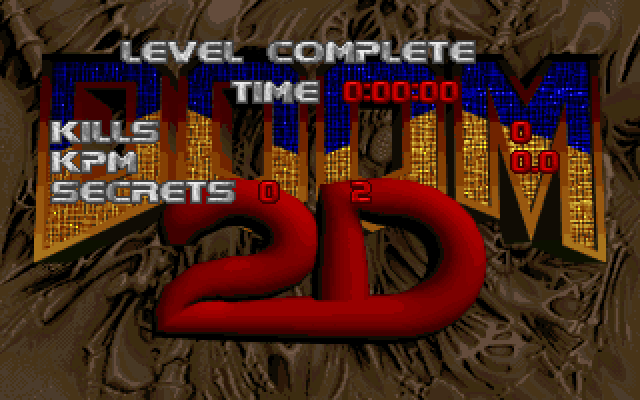
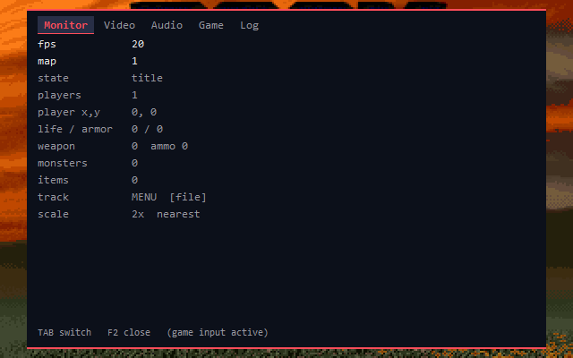
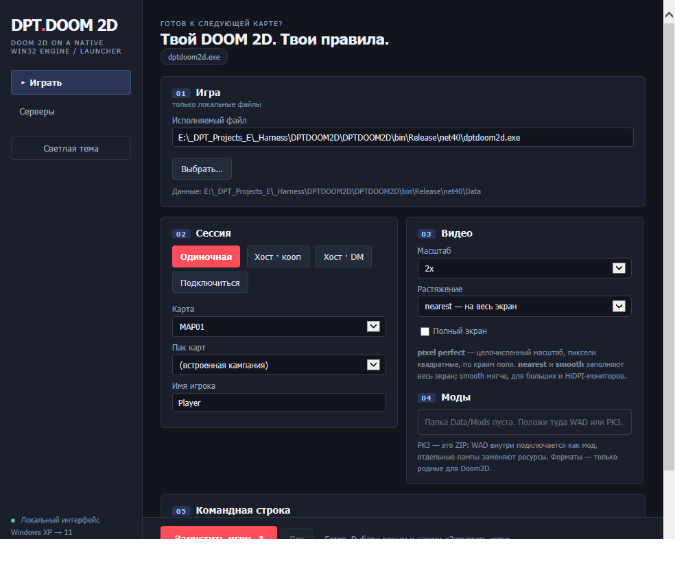
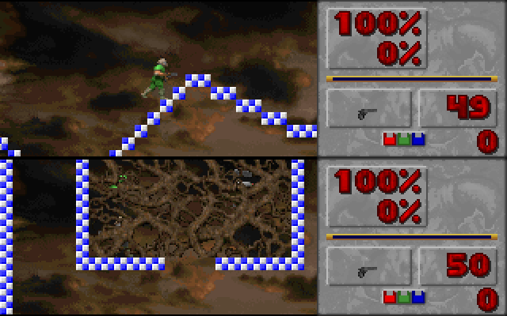

<div align="center">



**Doom 2D** (Prikol Software, 1996) — переписанный на нативный Win32/C#.
Геймплей один-в-один, движок свой, без сторонних библиотек.

[](../../actions/workflows/build.yml)


</div>

---

## Что это

Оригинальный Doom2D — DOS-игра 1996 года на C и ассемблере под VGA.
Этот репозиторий — её исходники, перенесённые на **C# с нативным Win32-слоем**:
те же карты, монстры, оружие, двери, ловушки, сохранения. Ничего не
«переосмыслено» — перенесено.

**Ни одной сторонней библиотеки.** Окно — `user32`, кадр — `gdi32`, звук —
`winmm`. Ни SDL, ни OpenGL, ни FNA, ни WebView: `dptdoom2d.exe` запускается
на Windows XP SP3 и на Windows 11 без установки чего-либо.

Рендер остался **программным и палитровым**: игра рисует в 8-битный буфер
320×200, ровно как оригинал, а GDI показывает его с целочисленным масштабом
1x…6x. Поэтому картинка совпадает с оригиналом пиксель в пиксель, включая
затенение по расстоянию, дым и цвет игрока.

<div align="center">

| | |
|---|---|
|  |  |
|  |  |

</div>

## Возможности

- **19 уровней** оригинала, все секреты, лифты, двери, ловушки, телепорты.
- **166 дополнительных карт** (Deluxe-эпоха: DM, кооп, арены) — библиотека в
  `Data/Maps`, выбирается через `-map-pack` или в лаунчере.
- **Моды в PK3** — обычный ZIP с WAD'ами и отдельными ресурсами; модкит
  (`--modbuild`, `--modlist`, `--modunpack`) встроен в игру.
- **20 видов монстров** с полным AI: погоня, стрельба, ближний бой, оживление
  трупов архивилом, «потерянные души» из Pain Elemental.
- **11 видов оружия**, броня, аптечки, ключи, powerup'ы.
- **Два игрока**: split-screen, кооператив и deathmatch.
- **Сеть**: lockstep по TCP, кооп и deathmatch на двух машинах, пароль,
  мастер-сервер и **релей** — играется через NAT без проброса портов.
- **Сохранения**: 7 слотов, формат совместим с оригиналом (`ver=3`).
- **Музыка**: собственный плеер FastTracker 2 (XM) — все 30 треков играют.
  Если XM-файла нет, трек конвертируется на лету из **DMM**-песни внутри WAD.
- **Звук**: 8-битные DMI-сэмплы, свой микшер, вывод через `waveOut`.
- **Три режима растяжения**: pixel perfect (целочисленно, с полями),
  nearest и smooth — для оконного и полноэкранного режима.
- **Оверлей по F2**: монитор (fps, карта, монстры, музыка) и настройки
  (масштаб, растяжение, яркость, громкости, трек, полный экран) — прямо в игре.
- **Логи**: `Storage/Logs/log_<дата>_<время>.log` рядом с exe и в консоль, через `Trace`.
- **Читы** оригинала: `IDDQD`, `RAMBO`, `TANK`, `BULLFROG`, `FORMULA1`,
  `UJHTW`/ГОРЕЦ, `,TKSQJHTK`/БЕЛЫЙ ОРЁЛ, `CBVCBV`/СИМСИМ, `GOODBYE`.
  Кириллические работают и с русской, и с английской раскладки — как в DOS-версии.

<table>
<tr><td></td><td></td></tr>
<tr><td></td><td></td></tr>
<tr><td colspan="2"><br><sub>Кастомная карта из библиотеки (<code>kozak__arena.wad</code>) — deathmatch на двоих</sub></td></tr>
</table>

## Быстрый старт

```powershell
git clone https://github.com/dpteam/DPTDoom2D
cd DPTDoom2D
./DPTDOOM2D/tools/fetch-data.ps1     # doom2d.wad + музыка из upstream (6 МБ)
./DPTDOOM2D/tools/build.ps1 -Run     # собрать и запустить
```

Нужен [.NET SDK](https://dotnet.microsoft.com/download) (9.0 или новее) для
сборки и Windows x64 для запуска. Больше ничего скачивать не надо.

Готовая сборка без SDK:

```powershell
./DPTDOOM2D/tools/build.ps1 -Pack    # dist/DPTDOOM2D/ — копируется куда угодно
```

В `dist/` лежат три программы:

| Файл | Что |
|---|---|
| `dptdoom2d.exe` | игра |
| `dptdoom2d-launcher.exe` | лаунчер: режим, карта, пак, моды, масштаб, сеть |
| `dptdoom2d-master.exe` | мастер-сервер + релей для игры через интернет |
## Кастомные карты

В `Data/Maps` лежит библиотека из **166 WAD'ов** эпохи Deluxe: deathmatch-арены,
кооп-карты, эксперименты сообщества. Формат — родной формат Doom2D
(`Doom2D\x1A`, версия 2), не Doom/Doom II.

Один пак на запуск:

```powershell
dptdoom2d.exe -map-pack kozak__arena.wad -warp 1 -deathmatch
dptdoom2d.exe -map-pack more__attack.wad
dptdoom2d.exe --maps            # что вообще есть в библиотеке
```

Почему один: каждый пак определяет свои `MAP01..MAP19`, и если загрузить все
сразу, останется тот, который прочитан последним. Поэтому папка — библиотека, а
не список загрузки.

В лаунчере это выпадающий список **Пак карт** — рядом с выбором уровня.

Карты из сообщества ссылаются на текстуры, которых в базовом WAD нет
(`WALL63_1`, `WS19_1`, CP1251-имена). Порт такие текстуры **не считает фатальной
ошибкой**: подставляет запасную и пишет в лог `map texture not found: '...'`.
DM-only карта без одиночного старта автоматически играется как deathmatch.

## Моды и модкит

Мод — это **PK3**, то есть обычный ZIP с WAD'ами и отдельными лампами внутри.
Файл, положенный в `Data/Mods`, появляется в лаунчере галочкой; включённые
передаются игре как `-file`.

Три команды встроены в саму игру:

```powershell
dptdoom2d.exe --modbuild mymod.pk3 modsrc\   # собрать из папки
dptdoom2d.exe --modlist mymod.pk3            # что загрузится, а что нет
dptdoom2d.exe --modunpack mymod.pk3 modsrc\  # распаковать обратно
```

Подробности и структура мода — в [docs/MODS.md](docs/MODS.md).

## Сетевая игра

**По локальной сети** — хост ждёт, гость подключается по адресу:

```powershell
dptdoom2d.exe -net host -port 5030 -map 1
dptdoom2d.exe -net join -address 192.168.1.10 -port 5030
```

**Через интернет** — мастер и релей, проброс портов не нужен:

```powershell
dptdoom2d-master.exe --port 25135 --relay-port 25136
dptdoom2d.exe -net host -master 1.2.3.4:25135 -relay
dptdoom2d.exe -net join -master 1.2.3.4:25135 -relay-session <id>
```

Хост печатает 32-символьный id сессии; его и передают гостю. Обе машины
подключаются наружу, поэтому играется из-за любого NAT.

Сеть — **lockstep**: обе машины считают один и тот же мир с одним зерном ГПСЧ,
по проводу идёт только ввод (4 байта на тик) и контрольная сумма мира. Если
суммы разойдутся, игра пишет `DESYNC` и номер тика, а не тихо расходится.

## Управление

| | Игрок 1 | Игрок 2 |
|---|---|---|
| Ходьба | `4` `6` на цифровой клавиатуре | `S` `F` |
| Смотреть вверх/вниз | `8` `5` | `E` `D` |
| Огонь | `Page Down` | `A` |
| Прыжок | `Delete` | `Q` |
| Использовать / открыть | `8` | `E` |
| Смена оружия | `Home` `End` | `1` `2` |

`Esc` — меню, **`F2` — оверлей**, `F1` — скриншот, `F3` — громкость,
`F4` — яркость, `F6` — сохранить, `F7` — загрузить, `F10` — выход.

## Документация

| Документ | О чём |
|---|---|
| [docs/ARCHITECTURE.md](docs/ARCHITECTURE.md) | слои, нативный Win32-слой, соответствие модулей C → C# |
| [docs/FORMATS.md](docs/FORMATS.md) | WAD, спрайты, карты, сохранения, DMI, XM, DMM |
| [docs/MAPS.md](docs/MAPS.md) | кастомные карты, библиотека паков, редактор |
| [docs/MODS.md](docs/MODS.md) | модкит: PK3, сборка, установка |
| [docs/LAUNCHER.md](docs/LAUNCHER.md) | лаунчер: HTML-интерфейс, мост, режимы |
| [docs/BUILDING.md](docs/BUILDING.md) | сборка, упаковка, CI, проверки без окна |
| [docs/NETWORK.md](docs/NETWORK.md) | протокол, lockstep, мастер, релей |
| [docs/CONTROLS.md](docs/CONTROLS.md) | управление, оверлей, читы |
| [docs/ROADMAP.md](docs/ROADMAP.md) | что осталось |
| [docs/PORTING.md](docs/PORTING.md) | журнал портирования: решения и грабли |

## Проверка

Порт проверяется прогонами **настоящего игрового цикла без окна** — это и есть
тесты. Кадр при этом сбрасывается в BMP, так что результат видно глазами:

```powershell
dptdoom2d.exe --simulate 300 out.bmp 1 "5:right,40:fire"   # 300 тиков на карте 1
dptdoom2d.exe --shell 140 out.bmp "5:space,20:enter"       # титул → меню → игра
dptdoom2d.exe --saveload 150                               # save/load, сверка состояния
dptdoom2d.exe --levelend 1                                 # выход с уровня → интермиссия
dptdoom2d.exe --music MENU                                 # разбор и рендер трека
dptdoom2d.exe --sounds                                     # все 140 звуков разбираются
dptdoom2d.exe --maps                                       # карты и библиотека паков
```

`tools/build.ps1` прогоняет все 19 карт, сохранения, фронтенд, все 30 треков
(из файлов и из WAD), все 166 паков карт и все 140 звуков; `-Net` добавляет
проверку сети и релея. Это же делает CI на каждый push.

## Структура

```
DPTDoom2D/
├─ DPTDOOM2D/              игра (C#)
│  ├─ Engine/              платформа: WAD, VGA, палитра, ввод, конфиг, логи
│  ├─ Audio/               свой микшер, waveOut, XM-плеер, DMM → XM
│  ├─ Win32/               окно, DIB-блиттер, Win32-объявления
│  ├─ Game/                геймплей: мир, игрок, монстры, оружие, меню
│  ├─ Net/                 lockstep, протокол, мост к игре
│  ├─ Ui/                  оверлей по F2
│  ├─ Maps/                библиотека кастомных карт (166 WAD'ов)
│  ├─ Mods/                сюда кладутся моды (WAD, PK3)
│  └─ tools/               сборка, упаковка, иконка, картинки, тесты сети
├─ DPTDOOM2D.Shared/       протокол мастера (общий для игры и сервера)
├─ DPTDOOM2D.Master/       мастер-сервер + релей
├─ DPTDOOM2D.Launcher/     лаунчер (HTML-интерфейс в WebBrowser)
├─ docs/                   документация и скриншоты
├─ resources/              иконка
└─ refs/                   исходники оригинала (не в git, см. fetch-data.ps1)
```

## Лицензия

**GPLv2** — порт является производной работой от Doom2D:Rembo, который
распространяется под GPLv2. Полный текст в [LICENSE](LICENSE).

Игровые данные (`doom2d.wad`, музыка) в репозиторий не входят и берутся из
upstream.

Оригинальные авторы Doom2D: Алексей Волынсков (движок), Владимир Калинин
(звук, уровни), Евгений Ковтунов (графика), Prikol Software, 1996.
Порт на Linux: Doom2D:Rembo, 2011.
