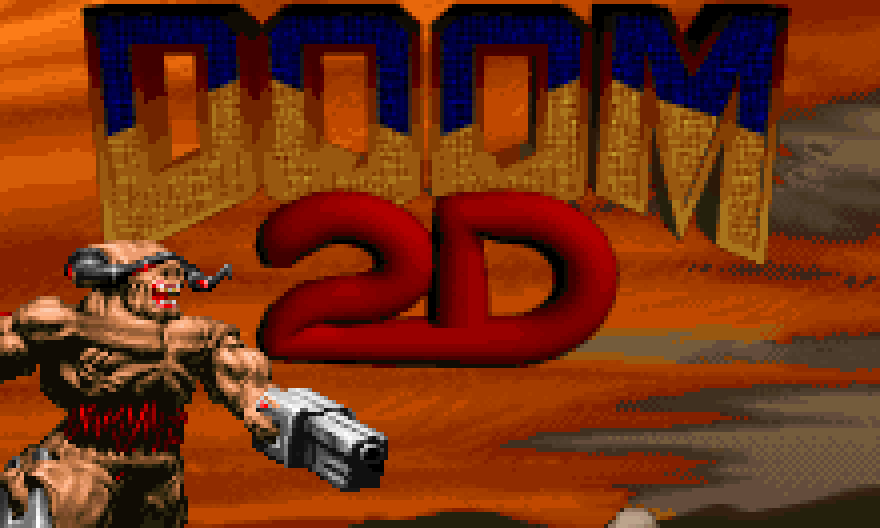
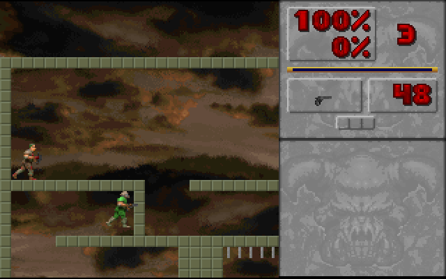
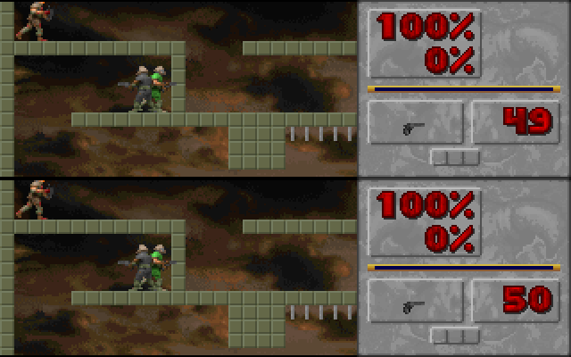
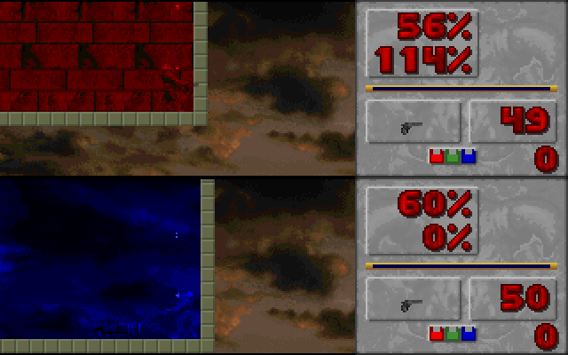
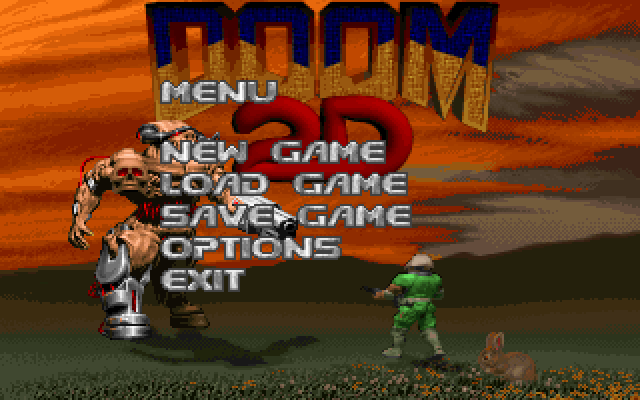

<div align="center">



**Doom 2D** (Prikol Software, 1996) — переписанный под XNA/FNA.
Геймплей один-в-один, движок современный.

[](../../actions/workflows/build.yml)


</div>


---

## Что это

Оригинальный Doom2D — DOS-игра 1996 года на ассемблере и C под VGA.
Этот репозиторий — её исходники, перенесённые на **C# + XNA/FNA**, с
сохранением всей игровой логики: те же карты, монстры, оружие, двери, ловушки,
сохранения. Ничего не «переосмыслено» — перенесено.

Рендер остался **программным и палитровым**: игра по-прежнему рисует в
8-битный буфер 320×200, а XNA только показывает кадр и играет звук. Поэтому
картинка совпадает с оригиналом пиксель в пиксель, включая затенение по
расстоянию, дым и цвет игрока.

<div align="center">

| | |
|---|---|
|  |  |
|  |  |

</div>

## Возможности

- **19 уровней** оригинала, все секреты, лифты, двери, ловушки, телепорты.
- **20 видов монстров** с полным AI: погоня, стрельба, ближний бой, оживление
  трупов архивилом, «потерянные души» из Pain Elemental.
- **11 видов оружия**, броня, аптечки, ключи, powerup'ы, бонусы к патронам.
- **Два игрока**: split-screen, кооператив и deathmatch, с фрагами и респауном.
- **Сохранения**: 7 слотов, формат совместим с оригиналом (`ver=3`).
- **Читы** оригинала: `IDDQD`, `RAMBO`, `TANK`, `BULLFROG`, `FORMULA1`,
  `UJHTW` (бессмертие), `,TKSQJHTK` (полёт), `CBVCBV` (открыть всё), `GOODBYE`.
- **Звук**: 8-битные DMI-сэмплы конвертируются в `SoundEffect` на лету.

<table>
<tr><td></td><td></td></tr>
</table>

## Быстрый старт

```powershell
git clone https://github.com/Doom2D/doom2d-xna
cd doom2d-xna
./Doom2D/tools/fetch-data.ps1     # doom2d.wad + музыка из upstream (6 МБ)
./Doom2D/tools/build.ps1 -Run     # собрать и запустить
```

Нужен [.NET SDK](https://dotnet.microsoft.com/download) (8.0 или новее) и
Windows x64. FNA-исходники и нативные библиотеки лежат в репозитории, так что
больше ничего скачивать не надо.

Готовая сборка без SDK:

```powershell
./Doom2D/tools/build.ps1 -Pack    # dist/Doom2D/ — копируется куда угодно
```

## Управление

| | Игрок 1 | Игрок 2 |
|---|---|---|
| Ходьба | `4` `6` на цифровой клавиатуре | `S` `F` |
| Смотреть вверх/вниз | `8` `5` | `E` `D` |
| Огонь | `Page Down` | `A` |
| Прыжок | `Delete` | `Q` |
| Использовать / открыть | `8` | `E` |
| Смена оружия | `Home` `End` | `1` `2` |

`Esc` — меню, `F1` — скриншот, `F2` — сохранить, `F3` — загрузить,
`F4` — громкость, `F5` — яркость, `F10` — выход.

## Документация

| Документ | О чём |
|---|---|
| [docs/ARCHITECTURE.md](docs/ARCHITECTURE.md) | как устроен порт: слои, рендер, соответствие модулей C → C# |
| [docs/FORMATS.md](docs/FORMATS.md) | форматы данных: WAD, спрайты, карты, сохранения, DMI |
| [docs/BUILDING.md](docs/BUILDING.md) | сборка, упаковка, CI, проверки без окна |
| [docs/CONTROLS.md](docs/CONTROLS.md) | управление и читы подробно |
| [docs/ROADMAP.md](docs/ROADMAP.md) | что осталось: музыкальный плеер XM и прочее |
| [docs/PORTING.md](docs/PORTING.md) | журнал портирования: решения и порядок работы |

## Проверка

Порт проверяется прогонами **настоящего игрового цикла без окна** — это и есть
тесты. Кадр при этом сбрасывается в BMP, так что результат видно глазами:

```powershell
Doom2D.exe --simulate 300 out.bmp 1 "5:right,40:fire"  # 300 тиков на карте 1
Doom2D.exe --shell 140 out.bmp "5:space,20:enter,40:space"  # титул → меню → игра
Doom2D.exe --saveload 150                              # save/load, сверка состояния
Doom2D.exe --levelend 1                                # выход с уровня → интермиссия
```

`tools/build.ps1 -Test` прогоняет все 19 карт, сохранения и фронтенд — это же
делает CI на каждый push.

## Структура

```
XNADoom2D/
├─ Doom2D/                 игра (C#)
│  ├─ Engine/              платформенный слой: WAD, VGA, палитра, звук, ввод
│  ├─ Game/                геймплей: мир, игрок, монстры, оружие, меню
│  ├─ Fna/                 мостик к FNA
│  └─ tools/               сборка, упаковка, генерация иконки и картинок для доков
├─ external/fna/           FNA (Ms-PL) + нативные DLL
├─ docs/                   документация и скриншоты
└─ refs/                   исходники оригинала (не в git, см. fetch-data.ps1)
```

## Лицензия

**GPLv2** — порт является производной работой от Doom2D:Rembo, который
распространяется под GPLv2. Полный текст в [LICENSE](LICENSE).

Игровые данные (`doom2d.wad`, музыка) в репозиторий не входят и берутся из
upstream. FNA — Microsoft Public License, см. [external/fna/LICENSE](external/fna/LICENSE).

Оригинальные авторы Doom2D: Алексей Волынсков (движок), Владимир Калинин
(звук, уровни), Евгений Ковтунов (графика), Prikol Software, 1996.
Порт на Linux: Doom2D:Rembo, 2011.
